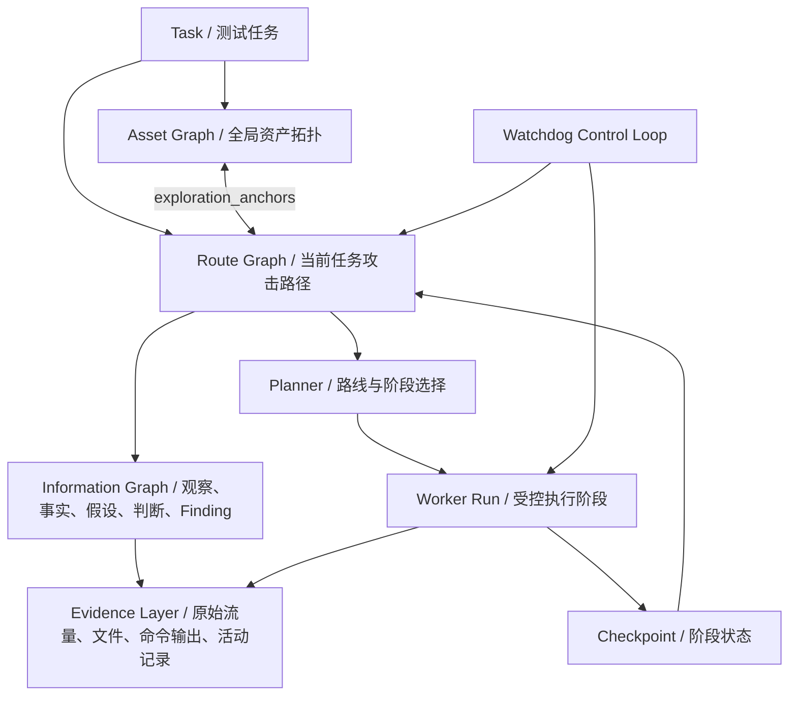

# ARTEX 优化方案

- 状态：讨论版
- 适用范围：真实 Red Team / Pentest 自治测试
- 当前动作：只读设计，不修改 Go、数据库、配置和前端代码
- 设计依据：ARTEX 当前实现、现有 Watchdog 文档、任务运行记录，以及 Super-agent 参考文献
- 设计原则：复用现有模块和数据，先明确语义和不变量，再决定是否增加数据库结构

## 1. 设计目标

ARTEX 已经具备完整的任务执行基础：

```text
Manager
  -> Engine
    -> Planner
    -> Worker x N
    -> Watchdog
  -> PostgreSQL
    -> Asset Graph
    -> Exploration Graph
    -> Activity / Traffic / Evidence
```

本方案面向真实 Red Team / Pentest，目标是：

- 让攻击路径可以跨多个 Worker Run 连续推进；
- 让每个运行周期具有独立、可累计的预算；
- 让 Watchdog 判断存活、进展、预算和运行结束；
- 让环境观察、模型判断和漏洞报告保持语义分离；
- 让原始证据可以独立保存和回查；
- 让服务重启、Provider 故障和 Worker 结束后可以恢复；
- 让图压缩不破坏因果关系、Checkpoint 和 Evidence 引用；
- 让现有 Engine、Planner、Worker、探索图、Evidence Store 和 Watchdog 继续承担主要职责。

## 2. 总体模型

方案采用三个逻辑图和一个证据层：



这里的“图”首先表示逻辑查询和语义视图，不表示立即建立三套数据库。

### 2.1 物理存储映射

| 逻辑对象 | 当前物理实现 | 方案中的职责 |
| --- | --- | --- |
| Asset Graph | `assets`、`companies`、`company_scope`、`task_scope`、`exploration_anchors` | 全局资产身份、拓扑、范围和当前视图 |
| Route Graph | `exploration_nodes`、`exploration_edges`、Intent payload、`worker_runs`、todo | 当前任务的路线、阶段、依赖、运行和检查点 |
| Information Graph | `fact` 节点、`activity`、finding 节点、来源任务关系 | 观察、事实、假设、判断、漏洞及来源关系 |
| Evidence Layer | traffic、`evidence.Store`、artifact、transcript、activity detail | 原始请求、响应、文件、命令输出和可审计记录 |

同一份正文只保存一次。其他图只保存 ID、摘要和来源引用。

### 2.2 不新增的模块

当前不建立：

- 全局 Router LLM；
- 独立 Operation 数据库层；
- 平行 Memory Store；
- 新的消息总线；
- 第二套 Evidence 存储；
- 第二套 Watchdog 状态机；
- 默认主动监听所有外部事件；
- 默认对真实目标执行投机动作。

Engine 已经承担确定性调度和运行控制。Planner 已经承担任务内路线选择。新增对象优先通过现有 Intent payload、fact、activity 和 `worker_runs` 表达。

## 3. 现有模块复用边界

| 需求 | 复用实现 | 设计用途 |
| --- | --- | --- |
| 任务生命周期 | `Manager`、`Task`、`Engine` | 任务创建、暂停、恢复、结束和删除 |
| 路线和阶段 | `Exploration`、goal、intent、edges | Route Graph 的主要物理基础 |
| Worker 执行 | `agent.Worker`、`runIntent` | 执行一个阶段并写回结果 |
| Worker Run | `run_id`、`worker_runs`、RunMonitor | 一次执行的状态和预算统计 |
| Worker 结束 | `Settlement`、`terminalreason.go` | 证据写回、Checkpoint、终态处理 |
| Watchdog | RunMonitor、Fast Path、Slow Path | 存活、进展、预算和结束判断 |
| 资产真值 | `assets`、scope、anchors | Asset Graph |
| 探索过程 | `activity`、transcript、trace tools | 原始过程和按需读取 |
| 交通证据 | traffic、`evidence.Store`、bindings、snapshots | Evidence Layer |
| 漏洞报告 | `findings`、`report_finding`、reporter、retester | Finding 生命周期 |
| 图压缩 | `coldgraph.go`、digest、Compaction、NOA、tool spill | 按图和按会话压缩 |
| Worker 协调 | `send_request`、`answer_request`、`release_request`、arbitration | 短期资源协调 |

## 4. Asset Graph

### 4.1 职责

Asset Graph 使用现有资产数据，回答：

```text
有哪些资产？
资产之间有什么拓扑关系？
哪些服务和端点属于某个主机或域名？
当前任务涉及哪些资产？
```

Asset Graph 记录：

- root domain；
- subdomain；
- IP；
- app；
- service；
- endpoint；
- port；
- technology；
- company 和 scope；
- 资产来源和最近观察时间。

Asset Graph 不保存：

- 完整攻击推理；
- 每次工具调用全文；
- 只对某个任务有效的模型判断；
- 未经来源和时间标记的临时环境状态。

### 4.2 资产身份与资产观察分离

同一个资产对象同时可能包含稳定身份和当前视图。二者必须区分：

```text
identity       资产身份和去重字段
observation    最近观察到的服务状态
validity       观察有效时间
provenance     观察来源
scope          任务或企业范围
```

例如端口开放状态必须关联：

- 观察时间；
- 观察任务；
- 观察来源 activity 或 Evidence；
- 有效期；
- 后续否定观察。

一次 Worker 观察不能自动成为永久资产真值。

### 4.3 Asset 与 Route 的关系

Route 通过现有 `exploration_anchors` 关联资产。Route 可以涉及多个资产，一个资产也可以参与多个 Route：

```text
Asset A
  -> SSRF
  -> Asset B
  -> credential
  -> Asset C
  -> privileged action
```

Route payload 只保存：

```json
{
  "asset_ids": [12, 34],
  "primary_asset_id": 12,
  "scope_reason": "由任务范围或某个事实产生"
}
```

完整资产信息通过 Asset Graph 查询，不复制到路线节点中。

## 5. Route Graph

### 5.1 Route 身份

Route 不能直接把每个 Intent 都当成一条新路线。一个攻击路径通常包含多个阶段和多个 Worker Run。

建议使用稳定的 `route_id` 语义：

```text
route_id = 首个路线 Intent 的 ID
continuation Intent 继承相同 route_id
每个 Intent 保留自己的 intent_id
每个 Worker Run 保留自己的 run_id
```

关系如下：

```text
route_id R1
  ├── intent_id I1
  │     ├── run_id W1
  │     └── checkpoint C1
  ├── intent_id I2
  │     └── run_id W2
  └── intent_id I3
        └── run_id W3
```

现有 `continuation_of` 继续表示相邻 Intent 的来源关系；它不单独承担 Route ID 的职责。

初期 `route_id` 放在 Intent payload，并由 `add_intent`、`continuation_of` 生成和继承。只有查询和并发一致性证明 payload 不足时，才考虑增加数据库字段或索引。

### 5.2 Route 内容

Route Graph 记录：

- Goal；
- Route；
- Intent；
- 阶段；
- 阶段依赖；
- Checkpoint；
- Decision；
- Route 的成功、阻塞、失败和替代状态；
- 对 Asset Graph 的引用；
- 对 Information Graph 和 Evidence Layer 的引用。

### 5.3 Route 阶段

阶段通过 Intent payload 和 Checkpoint 表达，不新增 Agent 角色：

```text
recon
validation
exploitation
privilege
lateral
objective
verification
evidence
cleanup
```

阶段迁移必须有支撑引用：

```text
当前阶段满足 success_condition
  -> 写入 Checkpoint
  -> Planner 选择下一阶段
```

### 5.4 Route 状态

使用现有 Intent 状态表达运行状态，在 payload 中补充路线语义：

```text
proposed
active
blocked
succeeded
failed
superseded
paused
```

现有状态映射：

| Route 语义 | 现有表达 |
| --- | --- |
| 待执行 | Intent `open` |
| 正在执行 | Intent `running` |
| 暂停 | Intent `paused` |
| 正常结束 | Intent `done` |
| 预算结束 | Intent `exhausted` |
| 外部故障 | Intent `blocked` + `blocked_reason` |
| 主动停止 | Intent `stopped` + `terminal_reason` |
| 删除路线 | 现有 Intent 删除流程 |

## 6. Information Graph

Information Graph 是全局可查询的信息索引，默认读取必须经过 Task、来源和时间过滤。它不是所有任务默认共享的事实池。

核心语义：

```text
Observation
  -> Claim
    -> Hypothesis
      -> Decision
        -> Finding
```

### 6.1 Observation

Observation 必须来自可回查来源：

- 工具结果；
- HTTP 请求和响应；
- traffic；
- 文件内容；
- 进程或系统状态；
- 服务端错误；
- 任务平台响应；
- 其他环境反馈。

Observation 不能只来自模型判断。

### 6.2 Claim

Claim 是对 Observation 的结构化归纳。可以继续使用 `fact` 节点，但 payload 需要明确类型：

```json
{
  "fact_type": "claim",
  "summary": "未认证请求可以读取用户列表",
  "confidence": "observed",
  "evidence_refs": ["traffic:123"],
  "source_activity_ids": [456, 457],
  "observed_at": "...",
  "valid_until": "..."
}
```

### 6.3 Hypothesis

Hypothesis 是模型或 Planner 提出的待验证假设：

```text
该接口可能存在对象级授权缺失。
```

必须记录：

- 提出者；
- 支撑 Claim/Evidence；
- 待验证动作；
- 当前状态；
- 过期时间或适用条件。

状态：

```text
open
supported
rejected
expired
```

Hypothesis 不能直接成为 confirmed fact 或 confirmed finding。

### 6.4 Decision

Decision 记录 Planner、Worker 或 Watchdog 的选择，不表示环境事实：

```text
基于未认证读取和可控对象 ID，下一步验证对象级授权边界。
```

Decision 必须引用：

- 支撑 Claim 或 Hypothesis；
- 被放弃的替代方向；
- 选择的 Intent；
- confidence；
- 产生时间。

存储位置按职责固定：

| Decision 类型 | 主存储位置 |
| --- | --- |
| 当前路线选择 | Intent payload |
| 阶段转移判断 | Checkpoint fact payload |
| Watchdog 运行判断 | Watchdog activity 和审计记录 |
| 临时模型判断 | transcript/activity，不进入长期 Information Graph |

### 6.5 Finding

Finding 是经过证据验证的安全问题，不是模型猜测或普通 Claim。

确认 Finding 必须有：

- 明确目标；
- 可复现请求、响应或命令输出；
- 真实影响；
- Evidence 引用；
- confidence；
- 产生 Finding 的 Intent；
- 资产引用；
- 报告和复测状态。

## 7. Information 写入不变量

现有 `record_fact` 是通用写入入口，后续必须由程序校验类型和引用，不能只依靠模型填写 `fact_type`。

| 类型 | 写入条件 |
| --- | --- |
| `observation` | 至少一个 activity、traffic 或 artifact 引用 |
| `claim` | 至少一个 Observation 或 Evidence 引用 |
| `hypothesis` | 有支撑引用、待验证动作和状态 |
| `decision` | 有支撑 Claim/Hypothesis、下一步 Intent 或 Checkpoint 引用 |
| `checkpoint` | 有 Intent、Run、阶段和预算信息 |
| `finding_candidate` | 有 Claim/Evidence 引用，但证据尚未满足 confirmed 条件 |
| `legacy_unknown` | 旧数据无法可靠分类时使用，不自动推断 |

这些不变量优先通过现有 `record_fact` 的 payload 校验实现。历史 fact 不自动回溯分类。

## 8. Evidence Layer

Evidence Layer 是逻辑证据层。当前 `evidence.Store` 是其中已经实现的 traffic evidence 存储模块，不应把两者名称混为一个物理组件。

### 8.1 当前 Evidence Store 的真实职责

当前 `evidence.Store` 主要提供：

- traffic request/response body；
- 内容寻址；
- SHA-256 校验；
- staging 和 durable write；
- `finding_traffic_bindings`；
- `traffic_evidence_snapshots`；
- evidence version；
- report evidence version。

命令输出、文件和一般 artifact 当前还可能位于：

- `activity.detail`；
- `data/tasks/...`；
- `cmd-output`；
- transcript；
- 工具生成的 artifact。

因此 Evidence Layer 可以引用所有来源，但不能声称所有来源已经具有 `evidence.Store` 相同的内容寻址和校验能力。

### 8.2 Evidence 不变量

- 原始证据只追加，不覆盖旧正文；
- Evidence 有稳定 ID、来源和创建时间；
- Finding 必须引用可回查 Evidence；
- Checkpoint 只能保存 Evidence 引用和摘要；
- 图压缩不能删除仍被 Finding 或 active Checkpoint 引用的 Evidence；
- 摘要不能替换原始 Evidence；
- Evidence 的来源必须能追溯到 activity、traffic、artifact 或其他可审计记录。

### 8.3 图之间的引用


规则：

- Asset 只保存资产拓扑、身份和当前资产视图；
- Route 保存攻击路径、阶段、Intent、Checkpoint 和引用；
- Information 保存 Observation、Claim、Hypothesis、Decision、Finding；
- Evidence 保存原始材料；
- 同一正文只保存一次；
- 其他图通过 ID、anchor 和引用字段连接。

## 9. 信息来源、继承和有效性

当前 ARTEX 没有独立 `Engagement` 对象。初期不用新增这一层，Information Graph 使用现有 Task 和 direct source task 关系表达范围。

全局查询必须使用：

```text
source_task_id
observed_at
valid_until
sensitivity
inheritance_policy
```

现有 `exploration_sources.go` 继续承担直接来源任务的只读继承：

- 当前任务可以读取直接来源任务；
- 继承节点带 `Inherited` 和 `SourceTaskID`；
- 来源任务内容只读；
- 不自动展开间接来源；
- 继承内容进入当前上下文前必须经过来源和有效期过滤。

### 9.1 默认可继承

- 长期稳定的资产身份；
- 已验证的服务技术；
- 明确版本条件下的代码或配置结论；
- 有效期明确的资产关系；
- 已验证的安全控制状态。

### 9.2 默认不可继承

- 凭据；
- session token；
- 临时端口状态；
- 目标内部文件内容；
- 用户数据；
- 未验证 Hypothesis；
- 模型 Decision；
- Task 特定的授权判断。

## 10. Checkpoint 与 Worker Run

### 10.1 Worker Run

复用现有 `run_id`、`worker_runs`、RunMonitor 和 activity。需要表达：

```text
run_id
intent_id
route_id
phase
started_at
cycle_start
last_event_at
last_output_at
last_high_value_progress_at
tool_calls
input_tokens
output_tokens
settlement_state
checkpoint_fact_id
```

新增数据库字段前，先从 activity result usage、RunMonitor 和 Intent payload 聚合。只有聚合不能提供稳定结果时，才增加字段。

### 10.2 Checkpoint

Checkpoint 使用现有 fact 节点，payload 需要包含：

```json
{
  "fact_type": "checkpoint",
  "route_id": "R1",
  "intent_id": 101,
  "run_id": "run-...",
  "path_phase": "validation",
  "summary": "已确认未认证读取，尚未确认对象级授权",
  "confirmed_claim_ids": [101],
  "open_hypothesis_ids": [102],
  "evidence_refs": ["traffic:123", "artifact:456"],
  "finding_ids": [],
  "attempted_actions": ["GET /admin", "GET /admin?id=2"],
  "next_actions": ["验证不同用户对象读取边界"],
  "budget_used": {
    "tool_calls": 18,
    "input_tokens": 42000
  },
  "created_by_run": "run-..."
}
```

### 10.3 Handoff

Worker Run 到达预算或 Watchdog 要求切换时：

```text
停止新的高成本动作
  -> 保存已确认事实和证据引用
  -> 记录未解决假设和下一步
  -> 进入 Settlement
  -> 写入 Checkpoint
  -> 结束当前 Run
  -> Planner 使用 continuation_of 创建下一阶段
```

新的 Run 继承同一 `route_id` 和剩余预算，不恢复完整预算。

### 10.4 Checkpoint 的压缩保护

当前 `coldgraph.go` 允许 settled Intent 和 fact 进入冷区。Checkpoint 必须增加保护规则：

- active Route 的 Checkpoint 保持 hot；
- active Intent 直接产生的 Checkpoint 保持 hot；
- settled Route 的旧 Checkpoint 可以进入 digest，但 digest 必须保留 `checkpoint_id`、`route_id` 和 Evidence refs；
- 被 active Route、Finding 或其他 Checkpoint 引用的 Claim 不得被物理删除；
- digest 只能替代上下文正文，不能替代引用和原始 Evidence；
- `covers` 关系继续只表示压缩视图，不参与真实因果关系。

## 11. Watchdog 设计

### 11.1 继续使用现有三层结构

保留：

- `RunMonitor`；
- Fast Path；
- Slow Path；
- `Settlement`；
- `watchdog_jobs`；
- `watchdog_requests`；
- `worker_runs`。

### 11.2 Fast Path

Fast Path 负责确定性判断：

- Run 是否存在；
- Task 是否暂停、删除或结束；
- Task deadline 是否到达；
- Worker Run 是否超过固定预算；
- Route 是否超过累计预算；
- 工具是否超过单次时限；
- 是否存在重复动作；
- 是否发生 provider error；
- 是否收到暂停、停止或 Settlement 请求。

Fast Path 不等待模型。

### 11.3 Slow Path

Slow Path 输入增加：

- 当前 Goal；
- 当前 Route objective；
- 当前 phase；
- 最近 Checkpoint；
- 最近高价值 ProgressEvent；
- 当前 Run 和 Route 预算；
- 重复动作摘要；
- Evidence refs；
- Finding Candidate 状态。

输出继续使用：

```text
continue
terminate
ask_user
provider_error
```

内部通过 `Settlement reason=handoff` 表达切换新的 Worker Run，不新增外部状态类型。

### 11.4 ProgressEvent

当前 Watchdog 把 facts/assets/finding 写入视为有效写入。后续在 activity metadata 或 fact payload 中记录事件类型：

```text
observation
new_asset
new_claim
hypothesis_supported
hypothesis_rejected
validated_weakness
credential_obtained
privilege_change
lateral_progress
objective_milestone
finding_written
cleanup_completed
duplicate_action
provider_failure
```

规则：

- `new_asset` 更新 activity，但默认不恢复完整预算；
- `validated_weakness`、`privilege_change`、`objective_milestone` 可以重置当前观察计时；
- `duplicate_action` 不重置周期；
- `finding_written` 更新 Finding 和 Route 状态；
- 普通 Claim 只有关联当前 objective 时才算高价值进展。

### 11.5 周期和累计预算

`watchdog_max_auto_cycles` 只表示自动继续周期数量，不承担完整运行预算。

需要区分：

```text
Task deadline
Route deadline
Worker Run deadline
Tool deadline
Token budget
Tool-call budget
```

新 Run 继续同一 Route 时继承剩余预算。

## 12. Planner 设计

Planner 继续是唯一 Intent 生成者，不新增全局 Router LLM。

每轮 Planner 从现有工具和数据中读取：

```text
当前 Route
当前 phase
当前 Checkpoint
剩余预算
最近高价值进展
未解决 Hypothesis
相关 Evidence refs
当前 Findings
```

复用：

- `graph_overview`；
- `node_detail`；
- `list_facts`；
- `list_findings`；
- `get_worker_output`；
- `get_worker_trace`；
- `search_all_worker_traces`；
- persistent todo。

Planner 生成 Intent 时，Intent payload 至少包含：

```json
{
  "route_id": "R1",
  "route_kind": "path_stage",
  "objective": "验证对象级授权边界",
  "phase": "validation",
  "asset_ids": [12],
  "parent_intent_id": 55,
  "checkpoint_fact_id": 101,
  "expected_evidence": ["不同用户对象的响应差异"],
  "success_condition": "确认跨用户读取或排除该假设",
  "budget": {
    "max_tool_calls": 60,
    "max_input_tokens": 120000
  }
}
```

`open_intent_cap` 继续限制 frontier 数量，但不代表 Route 和 Worker Run 的预算。

## 13. Finding 生命周期

### 13.1 Candidate 的现有结构映射

初期不扩展 `findings` 表状态枚举。候选漏洞使用现有 `fact` 节点表达：

```json
{
  "fact_type": "finding_candidate",
  "summary": "未认证请求可能读取其他用户对象",
  "claim_ids": [101],
  "hypothesis_ids": [102],
  "evidence_refs": ["traffic:123"],
  "validation_state": "pending",
  "confidence": "medium"
}
```

只有证据满足确认条件时，才调用现有 `report_finding`，创建 `findings` 行和 finding 节点。

这样复用：

- `fact` 节点保存 Candidate；
- `findings` 保存 Confirmed Finding；
- `reporter` 生成报告；
- `retester` 处理修复验证。

### 13.2 Intent 结束时对账

复用 Worker 结束和 Settlement 流程：

```text
读取本 Run 新增 Claim/Hypothesis
  -> 读取相关 traffic/artifact
  -> 检查已有 Candidate 和 Finding
  -> 创建或更新 finding_candidate fact
  -> reporter 生成正式报告
```

确认 Finding 必须有：

- 明确目标；
- 可复现请求、响应或命令输出；
- 真实影响；
- Evidence 引用；
- 适用范围和时间；
- 不是模型推测或版本匹配推断。

## 14. 图压缩和查询

### 14.1 Asset Graph

- 使用现有程序去重；
- 使用 `last_seen` 和来源记录观察有效性；
- 不把攻击推理写入资产节点；
- 资产详情通过查询 Route Graph 反查路线；
- 资产图只保存资产身份、拓扑和当前资产视图。

### 14.2 Route Graph

主要物理基础：

- `exploration_nodes` 的 goal/intent/finding/hint/digest；
- `exploration_edges`；
- `exploration_anchors`；
- Intent payload；
- Checkpoint fact；
- `worker_runs`。

继续使用 `coldgraph.go`：

- live Intent 及其祖先保持 hot；
- settled Intent 和普通 Claim 经过冷却周期后可以压缩；
- Finding、Goal、Hint、Begin 和 active Checkpoint 不直接折叠；
- digest 使用 `covers` 关系；
- digest 不参与真实因果关系；
- content version 和 signature 防止重复摘要。

Route Graph 需要保留：

- active Route；
- active Checkpoint；
- 未解决 Hypothesis；
- active Finding；
- 下一阶段依赖；
- Evidence refs。

### 14.3 Information Graph

Information Graph 初期是现有数据的逻辑视图：

| 语义 | 当前来源 |
| --- | --- |
| Observation | activity、traffic、artifact |
| Claim | `fact` payload 中 `fact_type=claim` |
| Hypothesis | `fact` payload 中 `fact_type=hypothesis` |
| Decision | Intent payload、Checkpoint 或 activity metadata |
| Finding Candidate | `fact` payload 中 `fact_type=finding_candidate` |
| Confirmed Finding | `findings` 和 finding 节点 |
| provenance | source task、source run、activity id、evidence refs |

全局查询必须按以下条件过滤：

```text
source_task_id
observed_at
valid_until
sensitivity
inheritance_policy
```

`source_engagement_id` 当前不作为独立字段引入。当前使用 Task 和 direct source task 关系表达来源范围。

### 14.4 Evidence Layer

Evidence Layer 不参与有损图压缩。它保存或引用：

- 原始请求和响应；
- 命令输出；
- 文件快照；
- traffic body；
- artifact；
- screenshot；
- 审批和运行记录。

需要区分 Evidence Layer 和当前 `evidence.Store`：

- Evidence Layer 是系统语义层；
- `evidence.Store` 当前主要保证 traffic evidence 的内容寻址和一致性；
- 命令输出、文件和其他 artifact 目前还可能来自 activity detail、`cmd-output`、transcript 和任务目录；
- 文档不能把这些来源统称为已经具备相同的 hash、staging 和 GC 保证。

## 15. 恢复和持久状态

### 15.1 Engine 恢复

继续复用：

- `ResetRunningIntents`；
- Intent transcript resume；
- `worker_runs`；
- Watchdog cleanup；
- Settlement。

恢复时区分：

```text
Intent 状态
Worker Run 状态
Watchdog 控制状态
Route Checkpoint
Evidence 状态
```

旧 `run_id` 不能影响新 Run。新 Run 读取 Route ID、Checkpoint 和剩余预算。

### 15.2 服务重启

服务重启后：

- running Intent 重新开放或恢复；
- 旧 Watchdog job 标为 stale；
- 旧判断卡不作用于新 Run；
- 已写入 Claim、Finding、Evidence 保留；
- Planner 从最近 Checkpoint 继续；
- 累计预算不因重启恢复。

## 16. 实施阶段

### 阶段 1：观测和语义验证

不改变运行行为，检查：

- 每个 Run 的工具调用、token 和时长；
- Phase 变化；
- Claim/Hypothesis/Finding Candidate 写入；
- Watchdog decision 输入和结果；
- Slow Path 过期率；
- Settlement 结果；
- Finding 缺失位置；
- Checkpoint 是否被 digest 错误处理。

重点回放任务 #3276 的 `14438`、`14461`、`14424`。

### 阶段 2：Checkpoint 和 Route 累计预算

复用 Intent payload、fact、activity 和 `worker_runs`：

- 保存 route_id、phase、objective、next_actions、evidence refs；
- 计算 Worker Run 的工具、token 和时间使用；
- 新 Run 继承同一 Route 的剩余预算；
- Settlement 写入 Checkpoint；
- 检查现有聚合能否提供稳定查询；
- 只有无法聚合时才增加专门字段。

### 阶段 3：Watchdog 输入和进展判断

- Fast Path 读取固定预算和 Route 状态；
- Slow Path 读取 Checkpoint、Evidence 和 ProgressEvent；
- 普通 Claim/asset 不单独恢复完整周期；
- Watchdog 通过 Settlement reason 触发 handoff；
- 保留现有周期、判断卡、清理和 Settlement。

### 阶段 4：Finding Candidate 对账

- Run 结束时读取本 Run 新增 Claim/Hypothesis/Evidence；
- 创建或更新 `finding_candidate` fact；
- 证据满足条件后调用现有 `report_finding`；
- 使用现有 reporter 和 retester；
- 统计 Candidate recall、Confirmed recall 和报告完整度。

### 阶段 5：三图逻辑查询

- Asset Graph 使用现有 assets 和 anchors；
- Route Graph 使用现有 exploration nodes/edges、Intent payload、Checkpoint；
- Information Graph 使用 fact payload、activity、来源 metadata 和 findings；
- Evidence Layer 使用 evidence/traffic/artifact 引用；
- 前端先实现不同查询视图，不复制数据；
- 只有查询和事务验证证明现有结构不足时，才增加字段或表。

## 17. 验证方法

### 17.1 Watchdog 回放

使用现有 trace 和确定性模拟数据验证：

1. 持续写低价值 facts/assets，没有阶段进展；
2. 长工具持续产生阶段结果；
3. 相同工具、参数和结果重复执行；
4. Provider error 和重试；
5. Slow Path 晚于周期返回；
6. Watchdog 请求 Settlement；
7. Settlement 超时；
8. 同一 Route 开启新的 Worker Run；
9. 服务重启后恢复控制状态；
10. Finding 已经有证据但 Worker 没有主动调用 `report_finding`。

### 17.2 图语义验证

必须验证：

- Asset Graph 不混入模型判断；
- Route Graph 可以追踪 route_id、阶段和 Intent；
- continuation Intent 继承相同 route_id；
- Information Graph 能区分 Observation、Claim、Hypothesis、Decision；
- `record_fact` 不允许缺少必要来源的类型；
- Finding Candidate 不会自动伪装成 Confirmed Finding；
- Confirmed Finding 必须引用可回查 Evidence；
- Checkpoint 不会被当前 cold digest 规则物理删除；
- 全局 Information 查询不会自动跨任务泄漏敏感内容；
- digest 不改变因果关系；
- 删除或压缩 Route 节点不会删除仍被其他 Route 引用的 Claim 或 Evidence；
- Evidence 正文可以通过引用恢复。

### 17.3 主要指标

| 指标 | 目标 |
| --- | --- |
| 低价值持续运行的 handoff/终止率 | 提升 |
| 有价值长工具的误终止率 | 不增加 |
| Slow Path 过期率 | 降低并可解释 |
| Run 结束后 Evidence 保留率 | 100% |
| Checkpoint 恢复后的重复动作比例 | 降低 |
| Finding Candidate recall | 提升 |
| Confirmed Finding 的 Evidence 完整率 | 提升 |
| 单个已验证 Finding 的 token 成本 | 降低 |
| 服务重启后的运行状态恢复率 | 100% |
| 旧控制记录影响新 Run 的次数 | 0 |
| Claim 被错误当作 Observation 的次数 | 0 |
| 未引用 Evidence 的 Confirmed Finding 数量 | 0 |

## 18. 不纳入本方案

当前不建立：

- 全局 Router LLM；
- 独立 Operation 数据库层；
- 平行 Memory Store；
- 默认主动监听所有外部环境事件；
- 默认对真实目标执行投机动作；
- 新的消息总线；
- 跨任务共享完整 Worker 上下文；
- 将模型完整思维过程作为事实长期保存；
- 通过增加 Prompt 长度解决状态问题；
- 把所有命令输出和 artifact 强行迁移到当前 `evidence.Store`，除非先完成独立的数据迁移设计。

## 19. 方案依据

- ARTEX 架构说明：[README.md](../README.md)
- ARTEX Watchdog 设计：[ARTEX-Watchdog优化方案-11-19.md](./ARTEX-Watchdog优化方案-11-19.md)
- ARTEX Watchdog 施工记录：[ARTEX-Watchdog优化施工方案-11-19.md](./ARTEX-Watchdog优化施工方案-11-19.md)
- ARTEX 当前实现：`server/engine.go`、`server/task_llm.go`、`server/watchdog_*.go`、`agent/planner.go`、`agent/worker.go`、`db/exploration.go`、`evidence/store.go`
- Super-agent 设计参考：[Super-agent 设计探索 - 迈向更自主的 Agent 系统](<C:/Users/Administrator/Desktop/Agent/test/Super-agent 设计探索 - 迈向更自主的 Agent 系统.md>)
- NIST SP 800-115：测试规划、执行、分析、数据处理和报告：[NIST SP 800-115](https://nvlpubs.nist.gov/nistpubs/legacy/SP/nistspecialpublication800-115.pdf)
- OWASP AI Agent Security：[AI Agent Security Cheat Sheet](https://cheatsheetseries.owasp.org/cheatsheets/AI_Agent_Security_Cheat_Sheet.html)

## 20. 最终设计判断

ARTEX 适合沿用现有的 Task、Exploration、Engine、Planner、Worker、Watchdog、Settlement 和 Evidence 实现，建立以下逻辑模型：

```text
Asset Graph
  全局资产身份、拓扑、范围和当前资产视图

Route Graph
  当前任务的稳定 route_id、阶段、Intent、Checkpoint 和 Decision

Information Graph
  Observation、Claim、Hypothesis、Finding 及其来源关系

Evidence Layer
  原始流量、文件、命令输出、artifact 和 activity 引用
```

三图不复制数据：

- Asset Graph 通过 anchors 被 Route Graph 引用；
- Route Graph 使用 Information Graph 的 Claim、Hypothesis 和 Decision；
- Information Graph 使用 Evidence Layer 的原始证据；
- Finding 通过 Evidence refs 形成可复核报告；
- Checkpoint 保护路线状态、预算和证据引用；
- cold digest 只压缩允许压缩的逻辑视图，不删除 active Checkpoint 和 Evidence。

最终优化重点是把现有对象之间的职责连接清楚：

```text
Planner 选择路线阶段
Worker 执行受控阶段
RunMonitor 记录运行状态
Watchdog 判断存活、进展和预算
Settlement 保存 Checkpoint
Exploration Graph 保存路线血缘
Information Graph 保存认识状态
Evidence Layer 保存原始材料引用
Reporter 生成报告
Retester 验证修复
```

最重要的设计是让同一条攻击路径可以跨多个受控 Worker Run 继续，同时保证：

- 资产身份和资产观察分离；
- Route ID 在 continuation Intent 之间保持稳定；
- Observation、Claim、Hypothesis、Decision 和 Finding 语义分开；
- 每个 Claim 和 Finding 的来源可以回查；
- Checkpoint 受到图压缩保护；
- 全局信息按来源、时间和任务范围过滤；
- Watchdog 具有明确的控制输入；
- 压缩和 handoff 不改变事实来源。
